# Dibbs page-by-page overhaul

Audit of every screen, 2026-10-22. Screenshots are the web build at iPhone width
(390×844), signed in as the demo users Maya (seller and moderator) or Jordan
(buyer), against local demo data. Native iOS can differ in small ways.
Regenerate the screenshots after each group ships to compare before and after.

## How to use this

1. Pick a group (start with **0 · Shared building blocks**, then 1 → 7).
2. For each page, write what you want under **Your call**. Keep, cut or change
   any suggestion, or add your own ideas. The questions there are prompts, not
   decisions.
3. Each group is then built on its own branch, one commit per page, checked with
   typecheck, the related test script and fresh screenshots, and merged as one PR.

Tags: **Bug**, **Function** (works but clunky), **Design**, **Feature**.
**P1** = broken, confusing or damages trust. **P2** = clear improvement.
**P3** = nice to have. "Needs owner OK" = outside the scope approved in
`docs/PROJECT-DIRECTIVES.md`.

## The pitch (owner, 2026-10-22)

Every page's copy should sell these three reasons, in this order:

1. **Quick, no haggling.** No negotiation and no spam lowballing. The buyer
   decides whether the price is right and agrees to the time and place.
2. **Sell the same day.** Need money for the bar, a trip or anything else? Sell
   the thing you haven't touched in months today, without hassle.
3. **Free.** No fees or transaction costs: sellers keep 100% of their price.
4. **Safe and sure.** Meetups happen at public spots on campus, peer to peer
   with other students, at a time both people agreed to. Write it as facts the
   app makes true (public campus spots, campus-email-verified students, a booked
   time with a reminder, report and block). Never write it as a guarantee: avoid
   "always show up" and "no safety concerns", which the product rules forbid and
   the first no-show would disprove. Group 4 adds a "they didn't show up" path
   to back this up.

And the 24-hour rule is a feature, not a worry. If an item doesn't sell in a day,
the market has spoken: repost it at a lower price.

**Owner feature decisions (2026-10-22):**
- **Saved list.** ✅ Built (`934ae57`). Buyers keep a list of saved items they might want. Saving already
  works (the heart on cards and listings, swipe right, a Saved section on Profile);
  make the list easy to reach and useful. Because items expire after 24 hours,
  show "expires in Xh" on saved items and nudge the buyer before one disappears.
- **15-minute meetups.** ✅ Built (`a175089`). Sellers pick the time blocks they're available. The buyer
  agrees to one 15-minute slot inside a block (today the slot is 30 minutes).
  Change `MEETUP_SLOT_MINUTES` in `backend/trpc/lib.ts`, the slot grid checks in
  `backend/trpc/routes/reservation.ts` and `listing.ts`, the time picker and the
  booking copy, then run `test:workstreams` and `test:e2e` (they assume 30).

- **No payments for now.** ✅ Built (`ae75a83`). No platform fee and no card processing fee. Booking ends
  on a confirmation page, not a payment step: the buyer pays the seller in person
  however they agree. Set the platform fee to 0, remove the fee breakdown from
  booking, and turn `app/payments/[reservationId].tsx` into (or replace it with) a
  booking confirmation. Keep the Stripe code dormant, not deleted.

- **Posting access (2026-10-25, relayed by the "Email domain acceptance policy"
  session).** Founder sets each user to Default (verified campus email), Approved
  (a trusted non-.edu seller) or Blocked on /admin. Blocked only stops buying,
  selling, offers, booking and posting (the campusVerifiedProcedure set). Messages,
  comments, votes, likes and managing their own existing listings, offers and
  meetups stay open. Approved users show "Approved seller", never "Campus email
  verified". Open: approved sellers don't get booking confirmation emails yet
  (`backend/email/bookings.ts` skips users without a campus email).

**Conflicts with today's app, to settle before the copy changes:**
- The offers system lets buyers propose a lower price, and the Why page says
  "room to negotiate". That contradicts "no haggling".
- ~~The backend takes a 10% platform fee by default.~~ Settled: no fees and no
  payment step for now (see above).
- Relisting exists, but nothing nudges the seller to lower the price when they
  repost.

## Top fixes across the app

These P1s matter most, because they hurt trust or quietly lose people's work.

1. **The payment screen reads like real money in demo mode.** It says "seller is
   paid right away" and shows developer test-hook text (group 4, Payment).
2. **Headers.** The logo replaces every screen's title, some pages show two logos,
   and "Cancel" collides with the logo on the new and edit listing screens (group 0).
3. **A failed chat message looks sent,** and the typed text is lost (group 5).
4. **The 24-hour expiry is invisible** on cards and listing pages, even though it
   is a core rule (group 2).
5. **Requirements surface only after failure.** Signed-out visitors and buyers
   without a verified campus email only find out after tapping Book, Offer or
   Post (groups 2 and 6).
6. **An accepted offer is lost after sign-in.** The booking falls back to the
   asking price (group 4).
7. **Report and Block give no feedback** on profiles, and chat has no Report or
   Block at all (groups 2 and 5).
8. **Edit listing drops changes silently.** The red Remove button also sits right
   above Save (group 3).
9. **The legal pages don't list data the app now collects,** and still show
   `[FOUNDER TO CONFIRM]` placeholders (group 7).
10. **Tapping Sell can land on Browse.** `/sell` redirects to Browse instead of the
    new-listing form, so a direct link to it ends on Browse (group 3).

## 0 · Shared building blocks

Fix once, every page benefits. Do this before the page groups.

### Shared building blocks — `components/ui`, `constants/theme.ts`

1. **[P1 · Design]** **Header and back button.** The root stack puts the wordmark in the title slot for every screen (`app/_layout.tsx:79`), so pushed screens (listing, user, About) show only a logo with no screen title, and some pages then add a second logo. Drop the duplicate in `Screen` children (`InfoPage`, `AuthScreenShell`, Browse header) and show the screen name or a clear back label.
2. **[P1 · Design]** **Status colors used as decoration.** `successSoft`, `warningSoft` and `demoSoft` are cycled on the marketing cards (`components/marketing/InfoPage.tsx:16`, `app/welcome.tsx:179-181`). Because "Demo" purple and the green "verified" tone carry meaning elsewhere, reserve them for status. Add a neutral `tint` token.
3. **[P2 · Design]** **Ghost button doubles as a link.** `Button variant="ghost"` renders full-size 17px semibold black text that wraps to two lines (`components/ui/Button.tsx:78`). Add a real `link` variant (small, accent, underlined) and use it for "Skip for now", "Use your phone number instead", and the legal links.
4. **[P2 · Design]** **Typography is bumpy.** Pages override sizes ad hoc: `fontSize: 23`, `26`, `38`, `20`, `13` inline (`app/welcome.tsx`, `app/create-profile.tsx`). Extend the `type` scale (display-sm, lead, small) so screens stop inventing sizes.
5. **[P2 · Design]** **Link styling.** Bare `Link` and `Text onPress` are used for navigation with default blue or ink color and tiny hit targets (`app/auth/sign-in.tsx:29`, `components/marketing/InfoPage.tsx:20`). Create a `TextLink` component (accent, 48pt target, `accessibilityRole="link"`).
6. **[P2 · Function]** **Error and empty states are inconsistent.** `ErrorState` always says "Couldn't load this" and `EmptyState` is `accessibilityRole="text"`, which can hide its action button from screen readers on iOS (`components/ui/EmptyState.tsx:21`, `ErrorState.tsx:20`). Drop the role on the wrapper, allow a custom title, and add an inline `RefetchBanner` for failed refetches over stale data.
7. **[P2 · Design]** **Skeletons are not shaped like content.** Listing and profile loaders (`app/listing/[id].tsx:277-285`, `app/user/[id].tsx:62-69`) are a handful of bars with no gallery, price or chip placeholders, and the profile skeleton has a 96px circle of `radius={48}` only. Add shaped variants (`ListingDetailSkeleton`, `ProfileSkeleton`).
8. **[P3 · Design]** **Spacing.** Magic numbers (`marginTop: 56`, `paddingTop: 44`, `padding: 28`, `gap: 26`, `radius 22`) sit beside the 4-pt `space` scale and `radius` tokens. Add `space.section` (56) and `radius.xl` (22), and use them.
9. **[P3 · Design]** **Button touch targets.** `Button` is 48pt but text-only pills (`styles.navLink` 44pt on welcome, `styles.tab` 44) and the icon buttons are below or at the limit; confirm 48pt everywhere per DESIGN.md.
10. **[P3 · Design]** **Theme doc drift.** `docs/DESIGN.md` still lists the old tokens (`accent #C8442B`, system font); `constants/theme.ts` is now Montserrat with the logo red. Update the doc, since agents read it first.

**Your call:**
- Approve adding a `link` Button variant, a `TextLink` component and a neutral `tint` token? These are small changes that fix issues across most of these screens.

## 1 · First impression

What a new student sees before and during sign-up.

### Welcome — `app/welcome.tsx`
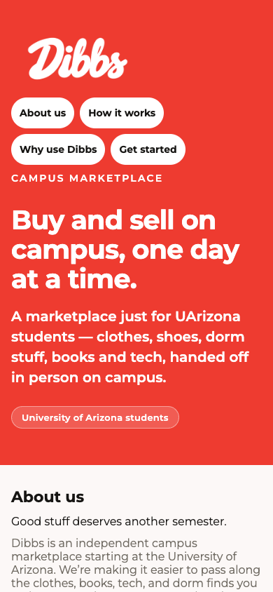

**Now:** Brand-red hero with four pill nav links, then About, Why-use, How-it-works steps, the live sign-up/log-in card, a "What Dibbs is not" strip and a footer.

1. **[P1 · Function]** On phones the sign-up card sits below About, Why and three How-it-works steps, so the first screen has no visible CTA. "Get started" is only a pill that jumps down. Put a primary "Create account" button in the hero that scrolls to the card (`app/welcome.tsx:157-165`).
2. **[P1 · Bug]** The nav scroll offsets come from `onLayout` values that mix coordinate frames. `sections.current.content + sections['How it works']` is the sum of a section's y and its parent's y. "Get started" additionally adds `cardOffset`, which is measured inside `panel`. On phones this can land past or short of the card. Measure the card directly with `measureLayout` or use anchors (`app/welcome.tsx:138,169-189,214`).
3. **[P1 · Design]** The four white pills wrap into two ragged rows and bury the tagline directly beneath them. "About us" and "Why use Dibbs" navigate away to new routes while the other two scroll, and nothing signals the difference. The About and Why-use sections are already inlined further down the page, so those two pills duplicate them. Cut the pills to "How it works" and "Log in", and add a Log in link top-right (`app/welcome.tsx:136-142`).
4. **[P2 · Design]** `animated: false` makes the jump jarring, and nav pills are `accessibilityRole="button"` where "link" fits better. Use animated scrolling and respect reduce-motion (`app/welcome.tsx:138`).
5. **[P2 · Bug]** The nav onPress is a single 400-character inline ternary, and the labels are hard-coded in an array. Extract a handler map. Hard-coded strings and an inline lambda are also a regression risk for the `sections` keys.
6. **[P2 · Function]** The card's tab pills and the "Log in" text link both toggle the same state. The link is a caption-sized `Text onPress` with a tap target well under 48pt. Drop the link, or make it a ghost Button (`app/welcome.tsx:108-119`).
7. **[P3 · Design]** The "What Dibbs is not" strip is good trust copy but sits below the fold, after the sign-up card. Consider a one-line "No payments held. A campus email is not an ID check." under the card (`app/welcome.tsx:217-225`).

**Your call:**
- Is the welcome page meant to be a long scroller (About and Why inline), or should it be a short hero plus the card, with About and Why on their own pages? Right now the content is duplicated between `/welcome`, `/about` and `/why-dibbs`.

### Sign in — `app/auth/sign-in.tsx`
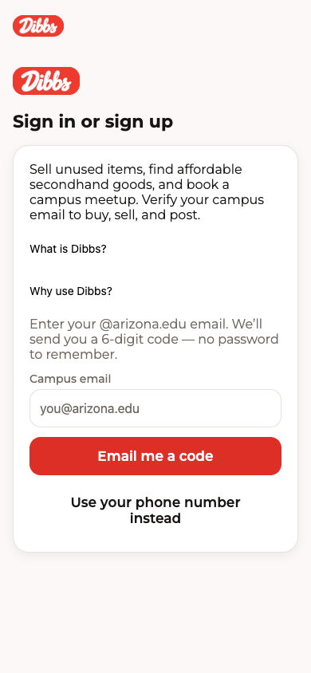

**Now:** Shell with logo, heading and a card holding a blurb, two plain links, and the email-code flow with a phone fallback.

1. **[P1 · Design]** The page shows two Dibbs logos (the stack header and the shell's own). The shell logo is redundant, since the header already carries the wordmark (`components/auth/AuthScreenShell.tsx:41`, `app/_layout.tsx:79`).
2. **[P1 · Design]** "What is Dibbs?" and "Why use Dibbs?" are unstyled, default-colored `Link`s with 12px padding, stacked between the blurb and the form. They look like leftover text, are small touch targets, and push the actual email field down. Restyle them as accent-colored small links and move them below the button (`app/auth/sign-in.tsx:29-30`).
3. **[P2 · Design]** Three consecutive body paragraphs (blurb, then the intro "Enter your @arizona.edu email…") are mixed in color and size: the first is ink, the second inkMuted. Merge them into a single intro line and put the explanation under the field (`app/auth/sign-in.tsx:28`, `components/auth/AuthMethods.tsx:17`).
4. **[P2 · Function]** The heading "Sign in or sign up" is ambiguous. The page doesn't say whether a new email creates an account (when does name and 18+/Terms appear?). Add helper text such as "New here? We'll ask for your name after the code." (`components/auth/EmailAuthFlow.tsx:2`).
5. **[P2 · Function]** `returnTo` is passed straight to `router.replace` as `never` with no validation, so an external or odd path can be injected. Allow only paths starting with `/` and not `//` (`app/auth/sign-in.tsx:24`).
6. **[P3 · Design]** The phone fallback button wraps to two lines and the card has no bottom padding balance, so the "Use your phone number instead" ghost button looks bolder than the primary label. Use a smaller text-link style.

**Your call:**
- Keep both `/auth/sign-in` and `/auth/email`, or redirect `/auth/email` to sign-in (as `/auth/verify` already redirects)?

### Email sign-in — `app/auth/email.tsx`
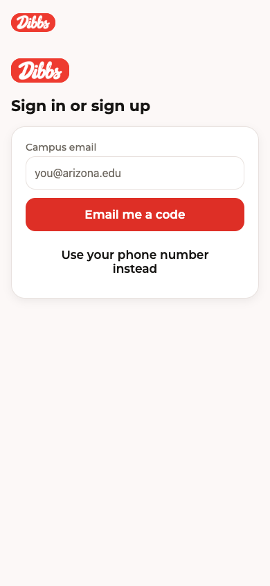

**Now:** Legacy route that renders the shell with only the email flow and a phone fallback link.

1. **[P1 · Design]** Same double logo as sign-in (header wordmark plus shell wordmark), and the two routes now differ visually (no blurb, no explainer). The page shows an input with no stated purpose beyond the label "Campus email" (`app/auth/email.tsx:18-28`).
2. **[P2 · Function]** The route is "kept for old links" but is still the target of `/auth/verify`. Make it `<Redirect>` to `/auth/sign-in` carrying `returnTo`, so there is one screen to maintain (`app/auth/email.tsx:1-5`, `app/auth/verify.tsx`).
3. **[P2 · Function]** `returnTo: returnTo ?? ''` is sent when the param is missing, giving the URL `?returnTo=` and relying on `||` downstream. Omit empty params (`app/auth/email.tsx:26`).
4. **[P3 · Design]** About half the screen is empty below the card. Anchor the card higher or add the "A campus email proves email control, not identity" note beneath it for consistency with the welcome strip.

**Your call:**
- Delete this route and redirect? It carries no unique behaviour.

### About — `app/about.tsx`
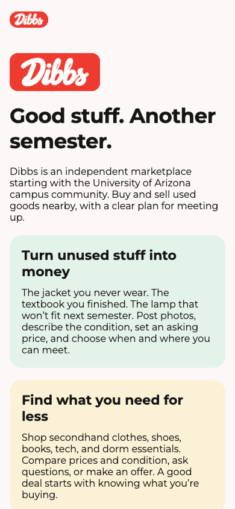

**Now:** A static page with a big heading, intro and four tinted cards (green, yellow, lavender, green).

1. **[P1 · Bug]** The page has no way to act. The only navigation is three links at the very bottom ("Get started / Log in" included). On a phone a reader must scroll the whole page to sign up. Add a sticky or top CTA (`components/marketing/InfoPage.tsx:20-22`).
2. **[P2 · Design]** The page shows two logos stacked: the header wordmark and a 150px block logo. The second adds nothing (`components/marketing/InfoPage.tsx:13`).
3. **[P2 · Design]** Cards cycle `successSoft`, `warningSoft`, `demoSoft`. Those are status colors (green = success, amber = warning, purple = "Demo" badge) used decoratively, which dilutes their meaning, and the amber card reads as a warning. Use neutral surface cards with the brand accent (`components/marketing/InfoPage.tsx:16`).
4. **[P2 · Design]** Bottom links are default-styled `Link`s with inline padding, and "What is Dibbs?" links to the page you are already on (`components/marketing/InfoPage.tsx:20-21`). Hide the current page's link.
5. **[P2 · Function]** `display` (34px) as the page title wraps to three lines with `numberOfLines` unset on narrow phones. Fine here, but long titles will push the content down; consider `title` size.
6. **[P3 · Copy]** "Turn unused stuff into money" and "arrange payment directly" are fine, but the page never says Dibbs holds no money. Add one line to the "real handoff" card to match the welcome strip (`app/about.tsx:7`).

**Your call:**
- Should About and Why-use merge into one page, given they are structured identically and linked to each other?

### Why use Dibbs — `app/why-dibbs.tsx`
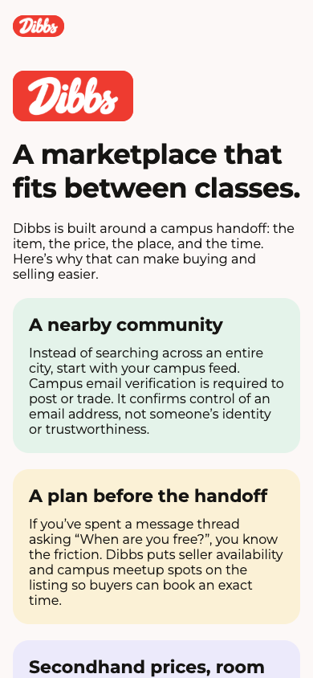

**Now:** The same InfoPage template with five tinted cards explaining the campus feed, booking, offers, the 24-hour feed and what Dibbs does not do.

1. **[P1 · Design]** The most important card, "Know what you're agreeing to" (no payment processing, no escrow or buyer protection), is last of five. The shipped product rule is that payment protection is never implied. Move it up, give it a distinct neutral style, and keep the green/amber/purple rotation off it (`app/why-dibbs.tsx:9`).
2. **[P2 · Design]** The intro card text ("A nearby community" onward) is a wall of body text per card. Shorten each card to two sentences and bold the lead phrase.
3. **[P2 · Bug]** "Never treat an upvote as a safety guarantee" refers to Community upvotes, which are not mentioned anywhere on this page, so the sentence lacks context (`app/why-dibbs.tsx:9`).
4. **[P2 · Function]** No CTA until the footer links (same template issue as About) (`components/marketing/InfoPage.tsx:22`).
5. **[P3 · Design]** Same status-color misuse and double logo as About.

**Your call:**
- Is a comparison ("Dibbs vs. Facebook Marketplace / Depop") wanted here? Competitor profiles exist in `competitor-profiles/` (needs owner OK for any public claims).

### Create profile — `app/create-profile.tsx`
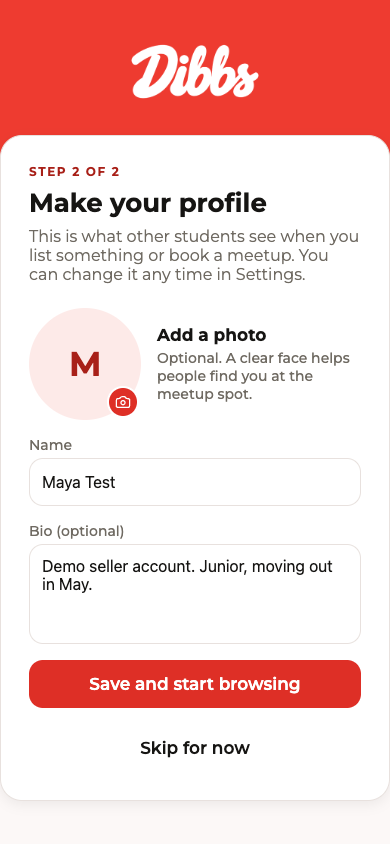

**Now:** Step-2 profile setup on a brand band with a lapping card: photo, name, bio, "Save and start browsing", "Skip for now".

1. **[P1 · Bug]** "STEP 2 OF 2" has no step 1 shown: sign-up is the card on `/welcome` and never labels itself as step 1. Either label it consistently or drop the counter (`app/create-profile.tsx:115-117`).
2. **[P1 · Function]** Silent loss of edits: if `uploadImage` fails the photo is cleared, but an in-flight `save` can still send an old `avatarUrl`; and `...(avatarUrl ? { avatarUrl } : {})` means a user can never clear a photo. Fine for onboarding but note it for Settings (`app/create-profile.tsx:96-100`).
3. **[P2 · Function]** `meQuery` errors are not handled: if `auth.me` fails the skeleton stays on forever (`loading = ... meQuery.isPending` is false on error, so the form shows blank). Show `ErrorState` with retry (`app/create-profile.tsx:33,103`).
4. **[P2 · Design]** The pre-filled name shows a demo name ("Maya Test") and "Skip for now" is a ghost button the same weight as the primary text, so it can't be told apart in the screenshot. Make it a small text link.
5. **[P2 · Function]** The camera permission request is made for the full media library on tap. On iOS `launchImageLibraryAsync` does not need that permission; requesting it first produces an unnecessary prompt (`app/create-profile.tsx:65`).
6. **[P3 · Design]** The avatar placeholder is a huge pale-pink circle with a single initial; add a dashed ring or "+" cue so it reads as tappable. The whole row is pressable but only the badge looks interactive (`app/create-profile.tsx:141-159`).
7. **[P3 · Copy]** "A clear face helps people find you at the meetup spot" nudges toward face photos for safety; fine, but the same sentence should not imply identity verification. Consider "so the person you're meeting can recognise you".

**Your call:**
- Should the profile step also ask for pickup preferences (usual spots)? (needs owner OK)

## 2 · Browsing

Finding an item and deciding to trade.

### Browse — `app/(tabs)/index.tsx`

**Now:** Pinned search and filter controls above a 2-column infinite grid with campus header, demo labels, skeletons, pull-to-refresh and swipe mode.

1. **[P1 · Design]** About 120px of header (logo, campus name, tagline, demo note) sits between the pinned filters and the first listing, and the Dibbs logo is already in the tab/stack chrome. Drop the logo and keep the campus name plus the demo note on one line to get the first row above the fold (`app/(tabs)/index.tsx:355-368`).
2. **[P1 · Design]** The filter chip row is cut off at the right edge ("Jewelry" half visible, "Pickup today", Price and Size are off-screen). Nothing hints that it scrolls, and the "Today" pickup toggle is the product's differentiator but is hidden (`components/browse/FilterBar`). Move "Pickup today" first, or add a fade at the right edge.
3. **[P1 · Function]** There is no expiry cue on cards. Listings die after 24h but the card says only "Today 10 AM–1 PM" in red. Add "Expires in 6h" (small, muted) to the card, which also supports the fresh-feed story (`components/ListingCard.tsx`).
4. **[P2 · Design]** The layers icon as the swipe/grid toggle is unlabeled and ambiguous, and on web it takes a permanent 48px slot beside the search. Use a text-labelled segmented control, or hide swipe behind a settings flag.
5. **[P2 · Bug]** `feedQuery.isError && items.length === 0` is handled, but when a refetch fails with items present nothing is shown, so stale data looks fresh. Add a small banner (`app/(tabs)/index.tsx:314`).
6. **[P2 · Function]** There is no sort control (newest, price low-high, ending soonest). With 24h expiry, "ending soonest" is the natural sort — needs owner OK if it requires an API change.
7. **[P3 · Design]** Every demo card repeats a "Demo" badge; fine per rules, but with all-demo data the grid looks noisy. Consider one campus-level notice plus a smaller badge.

**Your call:**
- Should Browse lead with "Pickup today" as the default filter? It is the brand promise and the demo data all has today's windows.

### Listing detail (public) — `app/listing/[id].tsx`

**Now:** A signed-out viewer sees the photo gallery, price, title, chips, description, pickup spots and times, seller, more-from-seller, and a sticky Message / Offer / Book meetup bar.

1. **[P1 · Design]** The photo-switcher dots render as two large numbered circles (about 40px, with a pink fill and a yellow second one) below the photo, which looks like a bug and steals space. Use small dots over the image (a11y label stays) (`components/PhotoGallery.tsx:132`).
2. **[P1 · Function]** A signed-out visitor sees Message, Offer and Book with no hint that they need an account, and tapping silently redirects to sign-in. Change the bar for signed-out viewers to "Log in to book" with the one-line reason ("Verify your campus email to trade") (`app/listing/[id].tsx:536-576`, `requireAuth`).
3. **[P1 · Function]** The page never shows when the listing expires. The 24-hour rule is a core product rule, yet `expire` appears only in the already-expired copy. Add "Expires in 5h" near the price, and a banner when under an hour (`app/listing/[id].tsx:310`, `StatusBanner`).
4. **[P2 · Design]** There is no back button: the header shows only the logo (`title: ''`), and the default Stack back arrow is not visible in the screenshot. The share and heart icon buttons are 48px, and the Offer button's accessibility label says "below the asking price" while the price is asking, fine, but the visible label is just "Offer" (`app/_layout.tsx:79,87`).
5. **[P2 · Design]** "Asking price" caption is 12px, beside the price at 17px, and the price looks small for the screen's main fact. Use a larger price (title size) (`components/ui/PriceText`).
6. **[P2 · Bug]** `slotsQuery` and `sellerTrustQuery` have no loading or error state: if slots fail, `bookable` stays true (`slotsQuery.data?.open !== false`) and the buyer can tap Book into an error. Treat a slot error as unavailable (`app/listing/[id].tsx:305-320`).
7. **[P3 · Design]** Seller's cropped-corduroy view shows the placeholder image with "Jacket" text; demo photos should look less empty (data, not code).

**Your call:**
- Should the Offer button be hidden for signed-out visitors, or should it open a sign-in sheet in place so they keep their context? (needs owner OK if it changes auth flow)

### Listing detail (seller view) — `app/listing/[id].tsx`
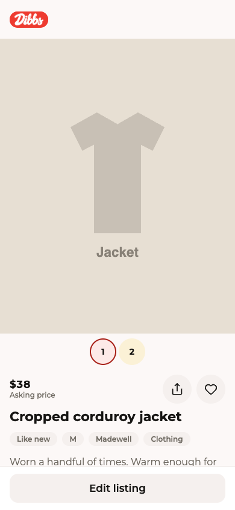

**Now:** The owner sees the same page with "Edit listing" as the only footer action, plus Offers and Booked meetups sections lower down.

1. **[P1 · Function]** The seller's page still shows the heart (save) and share buttons, and the seller can save their own listing. Hide Save for the seller (`app/listing/[id].tsx:337-358`).
2. **[P1 · Function]** The footer has only "Edit listing". The things sellers need (mark as sold, delete or take down, repost after 24h expiry) are missing or buried. Add "Mark sold" and "Take down"; for an expired listing add "Relist" (`app/listing/[id].tsx:520-530`, needs API check).
3. **[P2 · Design]** The offer and booking counts live far below the fold under Pickup. With a pending offer the seller must scroll to find it. Add a pill under the title ("2 offers · 1 meetup") that scrolls to the section.
4. **[P2 · Function]** Seller viewing an expired or sold listing still gets only "Edit". `StatusBanner` shows state but offers no action.
5. **[P3 · Design]** The "Report this listing" link is also shown to the seller (`app/listing/[id].tsx:497-505`); hide it for the owner.

**Your call:**
- Should the seller view be its own layout (a dashboard-style summary of offers and meetups above the item details)? (needs owner OK)

### Listing detail (buyer view) — `app/listing/[id].tsx`
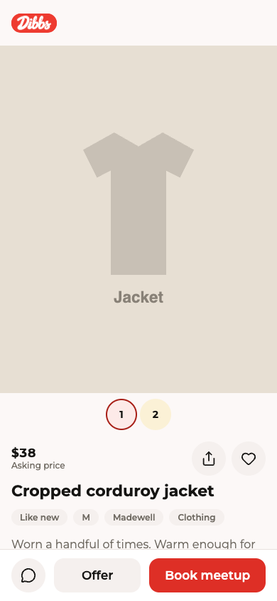

**Now:** A signed-in non-owner sees Message / Offer / Book meetup, plus an offer card if they have one.

1. **[P1 · Design]** This screenshot is identical to the public one: nothing signals that the viewer is signed in or what their state is (saved, offer pending, trading allowed). A buyer whose campus email is not yet verified, which gates trading per the directives, sees no hint here before the failure. Show a "Verify campus email to book" prompt up front (`app/listing/[id].tsx:536-576`).
2. **[P1 · Bug]** The Offer button's disabled check is `offers?.offers[0]?.status === 'pending'`, which only inspects the first offer. If the order changes, a second offer can be placed. Use `.some(o => o.status === 'pending')` (`app/listing/[id].tsx:553`).
3. **[P2 · Function]** The offer flow tells the buyer nothing about what happens next ("seller has until..."). Offer-accepted copy says the item is held for one hour; surface it on the buyer's card too (`BuyerOfferCard`).
4. **[P2 · Design]** The sticky footer has three controls at different weights (icon, grey, red), and the "Offer" button is not clearly secondary to booking at asking price. Label the bar "Book at $38" so the price is committed and visible (`app/listing/[id].tsx:560-575`).
5. **[P2 · Function]** `onMessage` creates a conversation on tap with no draft; users land in an empty thread. Prefill "Hi, is the jacket still available?" is the exact thing the product says it avoids, so instead prefill "Can you do Tuesday at 2?" or link to booking.
6. **[P3 · Design]** `openConversationMutation` errors use a native `Alert`; use an inline Notice for consistency.

**Your call:**
- Should a buyer be able to propose a time from the Message button, instead of Message and Book being separate paths? (needs owner OK)

### User profile — `app/user/[id].tsx`
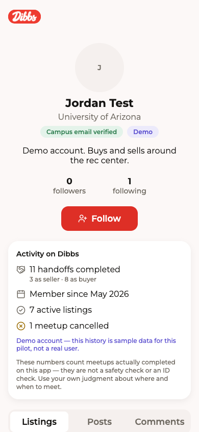

**Now:** A public profile with an avatar, name, campus, "Campus email verified" and Demo badges, bio, follower counts, Follow, a trust block, then Listings / Posts / Comments tabs, plus Report and Block.

1. **[P1 · Bug]** Report sends `reason: 'other'` with no details and no choice, and shows no confirmation or error after the request (`reportMutation` has no `onSuccess` or `onError`). The listing page has a proper `ReportSheet`; reuse it here (`app/user/[id].tsx:39,51-59`).
2. **[P1 · Bug]** Block has no `onError` and no success feedback; the button stays "Block" afterwards, and the profile screen doesn't indicate the user is blocked. Show a "Blocked" state with Unblock (`app/user/[id].tsx:33-38`).
3. **[P2 · Design]** The avatar is an enormous pale circle with a tiny "J" (96px circle, caption-sized initial). Scale the initial to the circle (`components/ui/Avatar.tsx:39`).
4. **[P2 · Design]** The trust card takes about 300px and pushes Listings (the point of the page) below the fold. Collapse it to the `TrustCompact` line with a "Details" expander (`app/user/[id].tsx:109-113`).
5. **[P2 · Function]** Tabs "Listings / Posts / Comments" are cramped, with "Comments" clipped on the right edge. Use a scrollable or equal-width tab row (`components/profile/ProfileContent`).
6. **[P2 · Design]** Report and Block sit as two full-width buttons at the very bottom; Block in solid danger red is the loudest thing on a stranger's profile. Move both into a "…" overflow menu in the header.
7. **[P3 · Copy]** The "Campus email verified" badge is correct, but add a tap-for-explanation ("not an identity check") like the DESIGN.md copy.

**Your call:**
- Should Follow and the counts stay? (Followers: 0 on a demo account looks empty and cuts against the no-fake-popularity rule; consider hiding counts below a threshold.)

## 3 · Selling

Posting and managing an item.

### Sell tab — `app/(tabs)/sell.tsx`
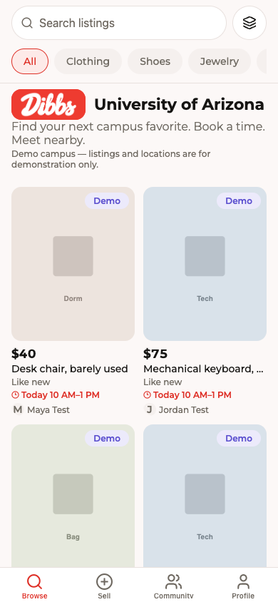

**Now:** Never renders itself. Tapping Sell pushes the `/listing/new` modal, and this file only redirects to Browse. The screenshot therefore shows the Browse feed, not a sell screen.

1. **[P1 · Bug]** A deep link or web visit to `/sell` lands on Browse with no explanation. The audit screenshot captured this redirect too. Redirect to `/listing/new` instead, which already handles the signed-out case. (`app/(tabs)/sell.tsx:9`)
2. **[P2 · Function]** There is no place to see your own listings from the Sell tab. Active, expired (relist) and offers-received only live in Profile. Make Sell a small hub: "Post an item" button, then "Your listings" with status and a Relist button. The tabPress interception would then go away. (`app/(tabs)/_layout.tsx:94`)
3. **[P3 · Design]** The "+" tab is a one-shot modal, so the tab bar never shows Sell as selected and back returns to wherever you were. This is acceptable. It only matters if item 2 is adopted.

**Your call:**
- Should Sell stay a one-tap modal, or become a "My listings" hub with a prominent "Post an item"?

### New listing — `app/listing/new.tsx`
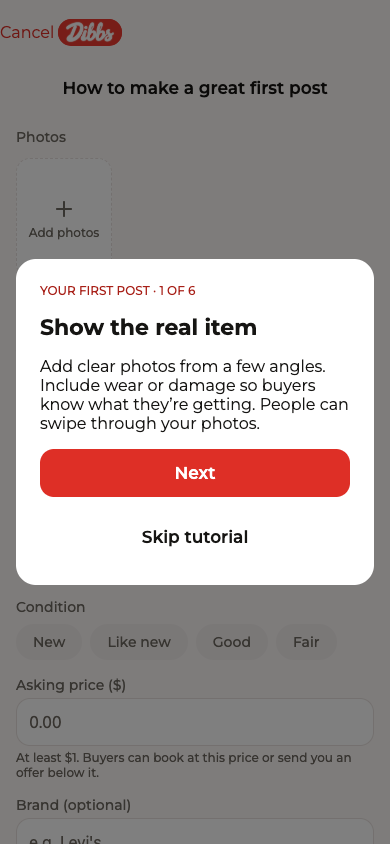

**Now:** Modal form (via the shared `ListingForm`) for photos, details, price, spots and meetup windows. The first-post tutorial opens automatically on first use. Publish leads to a share modal.

1. **[P1 · Bug]** "Cancel" sits flush against the screen's left edge and touches the logo, as you spotted. The root `headerTitle` Logo plus `headerLeft` leaves no gap. Wrap the Cancel in a Pressable with `paddingHorizontal: space.lg`/`marginRight`, or use `headerBackVisible` with a close icon. The "New listing" title is also never shown, because the Logo overrides it, so the page has no clear name. (`app/listing/new.tsx:92`, `app/_layout.tsx:79`)
2. **[P1 · Function]** The tutorial modal opens on every first visit and covers the form. Dismissing it via Android back (`onRequestClose`) hides it without saving "done", so it reappears next time. The 6 steps are a wall of text. Mark done on any dismissal. Consider 3 steps, or inline helper text under each field instead. (`components/sell/FirstPostTutorial.tsx:32`)
3. **[P2 · Design]** The "How to make a great first post" ghost button is permanently the top element, pushing Photos down. It stays visible after the tutorial is done, which makes it look like a page title. Replace it with a small "?" or "Tips" link in the header. (`FirstPostTutorial.tsx:31`)
4. **[P2 · Function]** Price parsing accepts "1.2.3" and "12.345". It also has no upper bound or `$` hint, and `priceCentsToInput` has a no-op replace. Use `maxLength`, two decimal places, and a sanity cap (for example $2,000, with a "Looks high" confirm). (`components/sell/ListingForm.tsx:82-93`)
5. **[P2 · Function]** The form is long, with no progress cue, and "Publish" is only at the bottom. Add a sticky bottom Publish bar with an inline "2 things left" summary that scrolls to the first error. Validation errors already exist and the scroll-to-error is fine. (`ListingForm.tsx:411`)
6. **[P2 · Design]** Description is optional, but the tutorial tells users to put flaws and measurements there. Add a placeholder or helper with those prompts. The 24h expiry rule is also only explained in tutorial step 6. Add one caption above Publish: "Live for 24 hours. Confirmed meetups still happen after it expires."
7. **[P3 · Feature]** "Suggest a price" from similar listings in the feed (a median of the same category and condition). Uses existing data, so it isn't one of the unapproved features.

**Your call:**
- Shorten the tutorial to about 3 steps, or replace it with inline tips?
- Should there be a price cap or a "high price" nudge?

### Edit listing — `app/listing/[id]/edit.tsx`
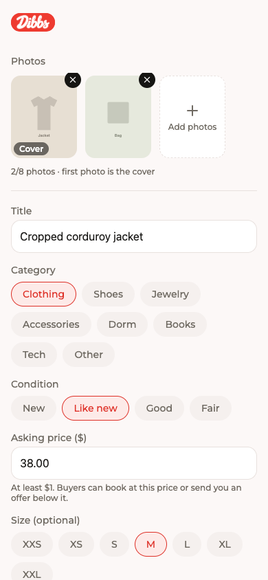

**Now:** Modal. Loads the listing, checks that you're the seller, and pre-fills the shared form. A "More" footer offers Relist (for expired or removed listings) and Remove.

1. **[P1 · Bug]** "Remove listing" is a red button placed right above "Save changes". It's a mis-tap risk, and the confirm doesn't mention active meetups or offers. Move Remove below Save as a text-style button, and warn when the listing has open reservations or offers. (`app/listing/[id]/edit.tsx:151-180`, `ListingForm.tsx:403`)
2. **[P1 · Function]** There is no discard-changes guard or Cancel. `onDirtyChange` isn't wired up as it is on the new-listing screen. Back or swipe-down silently drops edits. Add the same `confirmAction` and a Cancel button. (`edit.tsx:143`)
3. **[P1 · Function]** Editing the price or spots of a listing that already has a booked meetup, or an accepted offer, gives no warning. It isn't clear what happens to the existing booking. Show a notice ("Meetup already booked at $X; changes won't affect it") or lock those fields. Needs a check against `docs/CONTRACT.md`. (`edit.tsx:125`)
4. **[P2 · Function]** Windows already in the past are silently trimmed and the user is never told. Expired listings show both "Save changes" and a separate "Relist" form, which is confusing: Save does not relist. For expired or removed listings, hide Save and make Relist the primary action, or pre-fill the relist windows from the old ones. (`edit.tsx:114-123,158-168`)
5. **[P2 · Design]** Same header problem: the Logo replaces the "Edit listing" title, so nothing tells you this is an edit screen. Add a `headerRight`/Cancel, or put a visible "Edit listing" heading at the top. (`app/_layout.tsx:79`)
6. **[P3 · Function]** After Save and Relist, the user is dropped on the listing with no confirmation toast. A single "Saved" toast would help.

**Your call:**
- Should price and spots lock once there is a booking or an accepted offer?

## 4 · The deal

Booking, the meetup itself, and payment.

### Book a meetup — `app/reservation/request.tsx`
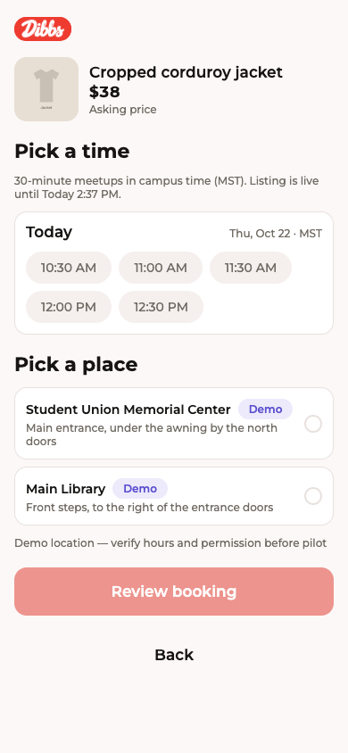

**Now:** The buyer picks a 30-minute time slot and a campus spot, reviews the price and a simulated fee, and books instantly. There is no seller approval step.

1. **[P1 · Bug]** The signed-out redirect drops `offerId` and `offerCents`, so an accepted offer is lost after sign-in and the booking falls back to the asking price. Pass all params in `returnTo`. (`app/reservation/request.tsx:52`)
2. **[P1 · Function]** The screen is a modal with no Close, only a "Back" ghost button below the fold, and the Logo header. Add a header close button. Also a booking is instant while the screen is still named "Request meetup" in layout/design docs and the file is `request.tsx`. This invites buyers to think it needs seller approval. Keep the "Book a meetup" wording everywhere. (`app/_layout.tsx:91`, `request.tsx:288`)
3. **[P1 · Bug]** If a slot is taken between "Review" and "Confirm" and you're sent back to "Pick", only a server error note appears. If a refetch drops the chosen slot while on the confirm step, `step === 'confirm' && pickedStart` fails and the screen silently falls back to the pick step with no message. Show "That time was just taken. Pick another." (`request.tsx:205,103-111`)
4. **[P2 · Design]** The disabled "Review booking" button is pale with no visible reason. Only the a11y label explains it. Add a visible hint under it ("Pick a time and a place"). Selecting a slot should also scroll to the place section. (`request.tsx:281-287`)
5. **[P2 · Design]** The price is not visible on the pick screen except in the small header. Also "Listing is live until Today 2:37 PM" can scare buyers into thinking the meetup expires. Add "A confirmed meetup still happens after the listing expires." (`request.tsx:251-256`)
6. **[P2 · Function]** An empty slot list shows both the "No open times" EmptyState and (when slots exist but none available) the greyed picker. Show one or the other, with a "Message seller" action rather than just "Back to listing". (`request.tsx:257-267`)
7. **[P3 · Design]** The confirm copy "You pay the seller in person or as you both agree" conflicts with the payments screen's "You pay now; the seller is paid right away". Use one consistent explanation. (`request.tsx:224`)

**Your call:**
- Booking is instant (no approval). Should the confirm screen say so plainly ("Seller is notified; this is booked")?

### Meetup card — `app/reservation/[id].tsx`
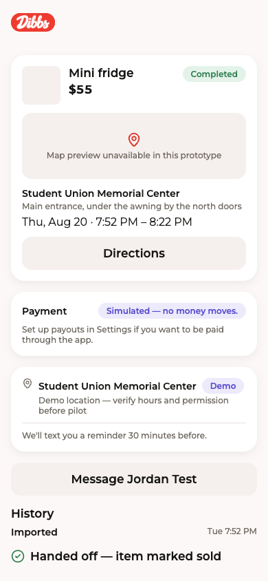

**Now:** Shared screen for buyer and seller showing item, price, spot, time, a payment row, history, and status-specific actions (handoff code or confirm, reschedule, cancel, report).

1. **[P1 · Bug]** `actionError` renders below the History section, often well below the button that failed (for example Confirm handoff) and offscreen. It is also never cleared on success or retry. Render the error directly above the relevant buttons and clear it when a new action starts. (`app/reservation/[id].tsx:~313`)
2. **[P1 · Design]** The spot appears twice: in the MeetupCard (name and description) and again in the info card (name, DEMO badge and hours). The card also carries a big "Map preview unavailable in this prototype" tile and Directions button even for a completed meetup. Merge the two into one spot block. Drop the map tile and Directions button once the status is closed. (`[id].tsx:~220-260`, `components/MeetupCard.tsx`)
3. **[P1 · Bug]** Time shows "Thu, Aug 20 · 7:52 PM – 8:22 PM" with no timezone label, and `timeZone` comes from the viewer's campus, which could be undefined. Pass the zone abbreviation, per the campus-local rule. (`[id].tsx:~207`)
4. **[P2 · Function]** There is no "No-show" or report path while accepted, only after completion (`CompletedActions`). Add "They didn't show up" and Report on accepted meetups past the start time. (`[id].tsx:~525`)
5. **[P2 · Function]** A completed card still shows "Message Jordan Test" and "Set up payouts in Settings…" (the payment row) with the same weight. Hide or collapse these when `status === 'completed'`, and surface a Review/Report action instead. The first-paint order should be status, then primary action, then details, then History. History currently sits above the actions.
6. **[P2 · Design/Maintenance]** The file is 844 lines. Split it into `components/reservation/` (`OpenActions`, `AcceptedActions`, `HistorySection`, `ProposeSheet`, `CancelSheet`, `ReportSheet`). The sheets and actions are already separate functions, so this is a move-only refactor. The requested and countered flow (accept, counter, decline) also appears to be legacy now that booking is instant. Confirm against `docs/CONTRACT.md`, then delete it, which would remove roughly 200 lines.
7. **[P3 · Bug]** The 8-second polling combined with `useIsFocused` is fine. However the "Imported" history label in the screenshot is a raw event name. Map every event type in `EVENT_LABEL` to plain language. (`[id].tsx:~571`)

**Your call:**
- Is the requested/countered (accept, counter, decline) flow still wanted, or can it be removed?
- Do you want the file split into components as a separate task?

### Payment — `app/payments/[reservationId].tsx`
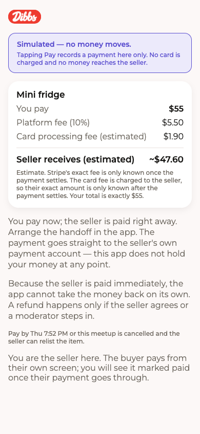

**Now:** Shows the fee breakdown, a "Simulated — no money moves" banner, and a Pay button for the buyer. The seller sees a read-only view.

1. **[P1 · Bug]** Trust-damaging copy sits under the simulated banner: "You pay now; the seller is paid right away… goes straight to the seller's own payment account." In demo mode it reads as real payment. Show it only when `!data.simulated`. In simulated mode use "Simulated — nothing is charged or paid out." (`app/payments/[reservationId].tsx:167-175`)
2. **[P1 · Bug]** In the screenshot (a completed meetup, seen as seller) the buyer-oriented "Pay by Thu 7:52 PM or this meetup is cancelled…" still shows. The "You are the seller" note is also at the bottom after the buyer-facing text. Gate the deadline and refund copy on `isBuyer && canPay`, and put the role note at the top. (`payments/[reservationId].tsx:177-197`)
3. **[P1 · Bug]** Developer text shows to users: "in simulated mode a payment only becomes paid when the local test hook sends the webhook." It is also wrapped in a `payment.status.replace('_', ' ')` that only handles the first underscore. Hide it behind `__DEV__` and use `replaceAll`. (`payments/[reservationId].tsx:215-222`)
4. **[P2 · Function]** `formatDeadline` uses the device locale and timezone, not campus time, and has no timezone label or date. Use campus timezone with an abbreviation. (`payments/[reservationId].tsx:37`)
5. **[P2 · Design]** The page is a heavy wall of grey text after the card. The seller's "estimated" figure and fee lines dominate. For the buyer, lead with a plain "You pay $55" and push the seller breakdown into a collapsible "How fees work". Add a link back to the meetup. (`payments/[reservationId].tsx:125-175`)
6. **[P2 · Function]** `error` has no `accessibilityRole="alert"`. There is no confirmation state after a successful simulated Pay except the invalidated query. Add a "Marked as simulated payment" confirmation. (`payments/[reservationId].tsx:209`)
7. **[P3 · Function]** The 24-hour payment deadline conflicts with "pay in person" on the booking confirm screen. Decide the real payment model (see the first item on the booking page).

**Your call:**
- Is the 24-hour pay deadline still a real rule, or should in-person payment stay the default while payments are simulated?

## 5 · Talking

Inbox and chat.

### Inbox — `app/inbox.tsx`
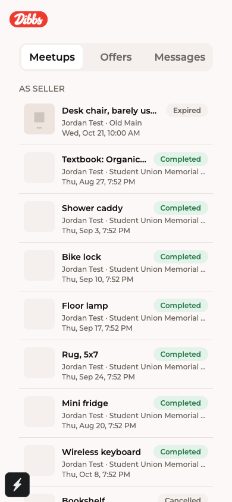

**Now:** Three-segment screen (Meetups, Offers, Messages) that polls every 10s and shows reservations grouped by role, offers with Accept/Decline, and conversations.

1. **[P1 · Function]** Meetups are not sorted by what needs action. In the screenshot an Expired row sits above a run of old Completed ones, and the "Needs your reply" rows are buried. Add Active/Upcoming above Past (collapse completed/cancelled/expired), sorted by `startsAt`; "As seller"/"As buyer" becomes secondary. (`app/inbox.tsx:398-411`)
2. **[P1 · Bug]** The Messages tab badge is clipped at the right edge of the segmented control at 390px, because three labels at `heading` size plus a badge overflow. Use `label` size and `adjustsFontSizeToFit`, or shorten the labels. (`components/inbox/SegmentedTabs.tsx:38-47`)
3. **[P2 · Bug]** Header and tabs disagree. The code sets the title "Meetups & messages", but the web header shows only the logo. The badge counts also differ: Meetups counts only requested/countered rows that need your reply, while Messages counts conversations, not messages, and the accessibility label says "N new". Make the "needs reply" definition shared, and decide on "new" vs "needs reply". (`app/inbox.tsx:134-148`, `components/inbox/SegmentedTabs.tsx:34`)
4. **[P2 · Design]** Thumbnails are blank grey squares in the screenshot (the seeded demo cover images are missing or slow). Add an image-error fallback icon and a "Demo" badge on demo reservations (`isDemo`). Truncated titles ("Desk chair, barely us…") plus a status pill leave little room; consider moving the status pill to its own line. (`components/inbox/ReservationRow.tsx:41-53`)
5. **[P2 · Bug]** On Offers, `actionError` only renders when offers exist and is never cleared on tab change. Accepting an offer says "first chance to book for an hour", which is the only place the hold length appears; confirm it matches the server and is shown on the offer row too. (`app/inbox.tsx:86-122, 324-328`)
6. **[P3 · Feature]** The Meetups empty state has no CTA. Add a "Browse listings" action, and a "Message a seller" action on the Messages empty state. (`app/inbox.tsx:244-252, 389-393`)

**Your call:**
- Should past meetups collapse by default under an "Earlier" header?
- Keep Offers as a top-level tab, or merge it into Meetups?

### Conversation — `app/conversation/[id].tsx`
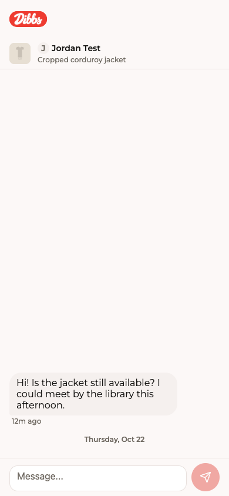

**Now:** Chat thread with a listing/person header bar, an optional meetup strip, an inverted message list with day separators, and an auto-growing composer. It polls every 5s and marks the thread read.

1. **[P1 · Bug]** A failed send looks sent. `onError` only sets `pending:false`, so the optimistic bubble stays with no "Not sent / Retry" state and the draft is lost. Show a failed state with tap-to-retry and restore the text. (`[id].tsx:141-143`)
2. **[P1 · Function]** There is no Report or Block entry point in the thread, though those behaviours must be preserved. Add a header "…" menu with Report / Block reusing the existing sheets, plus a one-line "Be careful sharing personal info; meet in public spots" note in the empty thread. (`[id].tsx:161-165`)
3. **[P2 · Bug]** In the screenshot the day separator ("Thursday, Oct 22") renders below the message instead of above its day group. In an inverted list the separator in the same row is flipped; verify on native and web, and consider placing it before the bubble. Timestamp "2m ago" beside the day label is also redundant. (`[id].tsx:324-333`)
4. **[P2 · Design]** The top area is crowded. The logo header, listing bar and meetup strip stack up, and the listing bar shows an avatar, a name and a title but no price. Add the price and a "Demo" badge, and make the tap target obvious (chevron). (`[id].tsx:167-190`)
5. **[P2 · Bug]** `keyboardVerticalOffset={96}` is hardcoded and `markRead` re-fires on every new message; `allMessages` sorting is unstable for equal timestamps. Use the real header height (`useHeaderHeight`) and a stable id tiebreak. (`[id].tsx:116, 229`)
6. **[P3 · Feature]** Add quick-reply chips ("Is this still available?", "Can we meet at …?") and a "Request meetup" shortcut when no reservation exists.

**Your call:**
- Add Report/Block to the conversation header now?
- Do you want quick-reply chips?

## 6 · Your stuff

Community, your profile and settings.

### Community — `app/(tabs)/community.tsx`
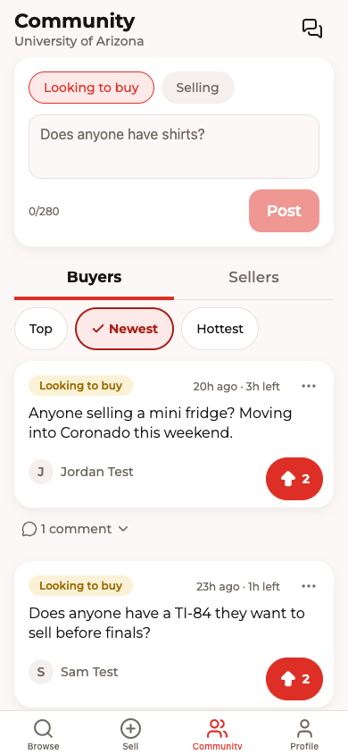

**Now:** The tab shows 24-hour campus posts, with a composer on top, Buyers/Sellers tabs, Top/Newest/Hottest sorts, upvotes, inline comments, and report/block/delete actions.

1. **[P1 · Function]** The composer's kind toggle ("Looking to buy"/"Selling") and the feed tab (Buyers/Sellers) are independent controls with different labels. A user can post as Selling while viewing Buyers and see nothing appear. Link them, or on success switch the feed to the posted kind, and show a "Posted — disappears in 24h" confirmation. (`app/(tabs)/community.tsx:113-114`, `components/community/PostComposer.tsx:22-34`)
2. **[P1 · Design]** The composer card takes about 200px at the top of every scroll and shows the same choice twice (composer chips plus Buyers/Sellers tabs). Collapse it to a one-line "Post something…" row that expands on tap. The 24h rule appears only in the empty state; add "Posts disappear after 24 hours" under the composer. (`PostComposer.tsx:40-73`)
3. **[P2 · Bug]** The upvote pill is absolutely positioned bottom-right over the card, so a long body or a long author name can collide with it. The "…" actions icon is also a small target. Reserve a footer row in `PostCard` instead of overlaying. (`components/community/FeedPost.tsx:31-33, 54`)
4. **[P2 · Function]** Report success only closes the sheet, with no "Thanks — we'll review it" confirmation, and block gives no feedback beyond the post vanishing. The inbox icon has no unread/needs-reply badge. (`community.tsx:98-100, 159-166`)
5. **[P2 · Bug]** An unverified campus email is only discovered after tapping Post, via the server FORBIDDEN error. Show a "Verify your campus email to post" notice (naming that exact check) up front and disable Post. (`PostComposer.tsx:32, 79-81`)
6. **[P3 · Design]** The sort pills are 48px tall with a thick border, so they look heavier than the tabs above them. Reduce to 40px pills with a 2px border. (`FeedControls.tsx:94-106`)

**Your call:**
- Collapse the composer behind a "Post something" row?
- Should posting auto-switch the feed to the matching tab?

### Profile — `app/(tabs)/profile.tsx`
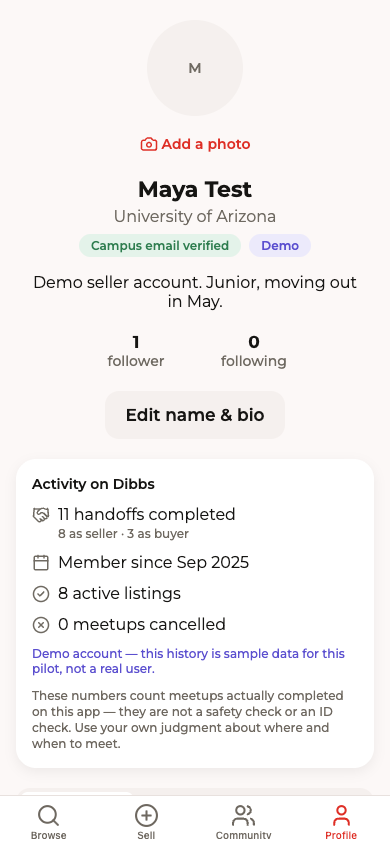

**Now:** The signed-in profile shows photo, name, badges, follower counts, an activity/trust block, profile content, inbox link, saved listings, a moderator link and Settings. A dev-only user switcher shows when `EXPO_PUBLIC_DEV_LOGIN=1`.

1. **[P1 · Design]** The page is very long and the important content is far below the fold. The 144px avatar block plus the Edit button and the trust card push the listings and Saved sections out of the first screen. Shrink the avatar to about 88px, put the name and badges beside it, and move the bio under the name. (`app/(tabs)/profile.tsx:95-125`)
2. **[P2 · Function]** "Edit name & bio" and "Settings" both route to `/settings`, which is redundant and puts the edit control in a button where an icon would do. Make the header action open edit directly, and move the gear to the top right. (`profile.tsx:112-117, 157-163`)
3. **[P2 · Design]** The Moderation section titles its only button "Moderation", repeating the heading. Hide the section title, or move it into Settings. (`profile.tsx:146-155`)
4. **[P2 · Bug]** The file header says "Listings / Posts tabs … sign out, close account" but the screen only renders `ProfileContent`; update it. `styles.header` and `styles.name` are unused. The privacy note under the inbox link is good, but the link itself sits between the grid and Saved with no unread badge. (`profile.tsx:1-7, 249-252`)
5. **[P2 · Function]** There are no per-section loading or error states for `trustQuery`: it simply renders nothing on failure or while pending. Show a skeleton, and a quiet retry on error. (`profile.tsx:123`)
6. **[P3 · Design]** The "Demo" badge sits beside "Campus email verified" and reads as one status. Label it "Demo account" (matching the trust block copy). Ideally the badge also wraps below the name rather than sharing a line at 390px.

**Your call:**
- Keep both Edit and Settings buttons, or merge them?

### Settings — `app/settings.tsx`
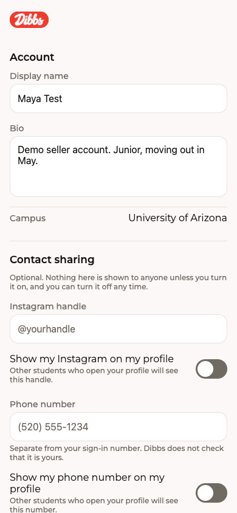

**Now:** A single long scroll with Account, Contact sharing, Account & phone, Payouts, Notifications, Safety, About this prototype, Legal, Sign out and Close account.

1. **[P1 · Design]** Switches are rendered very dark/grey when off and look disabled or stuck on. Use the accent track when on and the line colour (with a visible thumb) when off. Check the toggles' label wrapping: "Show my phone number on my profile" wraps and collides with the helper text. (`components/profile/ContactSharingSection.tsx`)
2. **[P1 · Function]** The "Account", "Contact sharing" and "Account & phone" sections overlap in meaning. Phone verified, campus email verified and phone shown to others are three different things; merge into "Verification" (Phone verified / Campus email verified, each named exactly, plus "Neither is an ID check") and a separate "Profile & contact sharing". (`app/settings.tsx:66-76`)
3. **[P2 · Function]** There is no save feedback visible: name and bio are editable inline with no obvious Save button or "Saved" confirmation in the first screen. Add a sticky Save bar with a dirty state, and warn on leaving unsaved edits. (`components/settings/AccountSection.tsx`)
4. **[P2 · Design]** The page is 10 sections of equal weight with no navigation. Add an in-page index or group into collapsible rows (Account, Privacy, Notifications, Safety, About/Legal), with Sign out and Close account clearly separated at the bottom. (`settings.tsx:66-108`)
5. **[P2 · Function]** The Payouts section talks about Stripe holding sales for N days while the product rule says payments are simulated. Confirm the copy always leads with "simulated" and never offers real onboarding unless it is enabled. (`components/settings/PayoutsSection.tsx:70-107`)
6. **[P3 · Feature]** Add "Download my data" and a data deletion contact link next to Close account. Both are mentioned as founder TODOs in `constants/legal.ts` — needs owner OK.

**Your call:**
- Merge the phone and email verification sections into one "Verification" block?
- Pay out or hide Payouts until real payments are approved?

## 7 · Trust and edges

Moderation, legal and dead links.

### Moderation — `app/moderation.tsx`
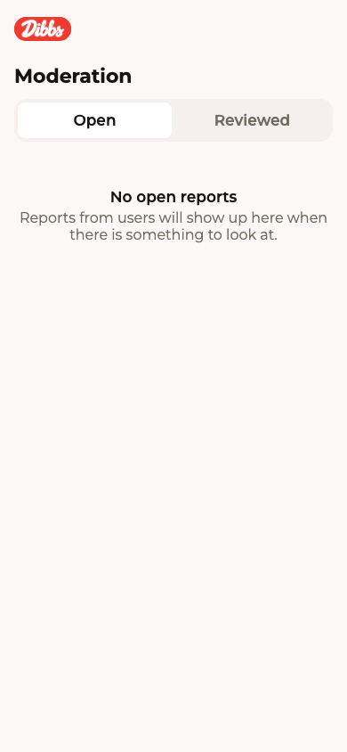

**Now:** A moderators-only screen that lists open or reviewed reports, with Dismiss, Remove listing/post and Add note actions.

1. **[P1 · Bug]** Removing a community post runs two non-atomic steps: `moderatorRemove`, then `reviewReport`. If the second call fails, the post is gone but the report stays open and the error only appears in the banner. Do it as one server action, or retry/mark reviewed on failure. (`app/moderation.tsx:92-109`)
2. **[P2 · Design]** The title "Moderation" is shown twice (native header and an in-page `Text`). There is no "Open (n)" count on the tab, so a moderator can't tell at a glance whether there is work. Add counts, and pull-to-refresh, which is missing on the report list. (`moderation.tsx:32-35, 142-148, 177-209`)
3. **[P2 · Function]** There is no way to act on a user report directly (suspend, warn); the only actions are Dismiss, Remove listing, Remove post and Add note. Also no report-to-target navigation for posts (`goToTarget` handles only listing/user). Open the post/author for `targetPostId`. (`moderation.tsx:114-120`)
4. **[P2 · Bug]** Per-card action loading states are keyed on different ids (`dismissingId`, `actionSheet?.report.id`, `removingPostId`), so while one mutation runs other cards' buttons stay enabled. Use one `pendingReportId`. (`moderation.tsx:112, 188-193`)
5. **[P3 · Design]** The empty state is correct but sits high and is sparse; fine for MVP. Add the report-reasons legend to `ReportCard` so reviewers know what each reason implies.

**Your call:**
- Make "remove post and close the report" a single server action?

### Legal pages — `app/legal/privacy.tsx`, `app/legal/terms.tsx`
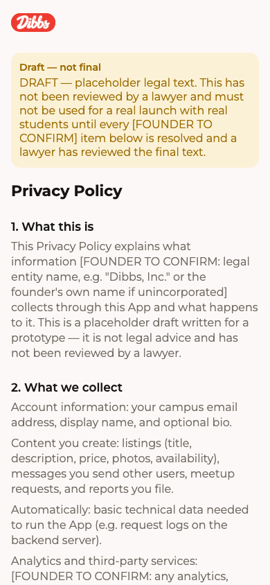
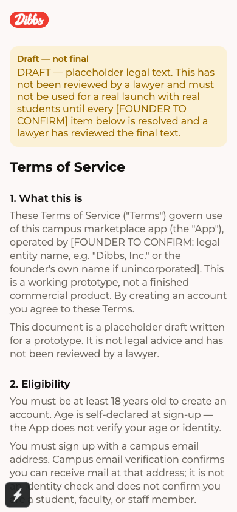

**Now:** Scrollable placeholder Terms and Privacy text from `constants/legal.ts`, headed by a "Draft — not final" warning banner and full of `[FOUNDER TO CONFIRM]` markers.

1. **[P1 · Bug]** Privacy "What we collect" does not mention data the app now collects: phone number (and whether it is verified), optional Instagram handle and phone shown on the profile, Community posts, comments and votes, offers, and the notification token. The Terms also say nothing about Community posts expiring after 24h, offers, or that phone verification is not identity verification. Update the text to match the shipped features. (`constants/legal.ts`, lines about 140-160 and 63-89)
2. **[P1 · Function]** Visible `[FOUNDER TO CONFIRM …]` placeholders are shown to real users: in the entity name, the contact email, retention and jurisdiction. Before any public launch, resolve them or hide the pages behind the draft banner. Tracked by the founder; not a code fix. Also add a contact email row and "Last updated" at the top (currently also a placeholder). (`constants/legal.ts:33-40`)
3. **[P2 · Design]** No table of contents or section anchors on a long page, and the legal-entity placeholders are inline in body text, which makes the first paragraph hard to read. Add a short "Summary in plain English" card and collapsible sections. (`app/legal/terms.tsx:26-50`)
4. **[P2 · Function]** The two pages are not linked to each other and there is no "Back to settings". Add cross links ("See also Privacy Policy") at the bottom. (`terms.tsx`, `privacy.tsx`)
5. **[P3 · Design]** Body text is `inkMuted` on `bg` at 16px; it is readable, but the heading hierarchy (title 22, headings 17) is flat. Use `inkMuted` only for secondary notes.

**Your call:**
- Replace the placeholder entity and contact details now, or keep the draft banner until a lawyer reviews them?

### Not found — `app/+not-found.tsx`
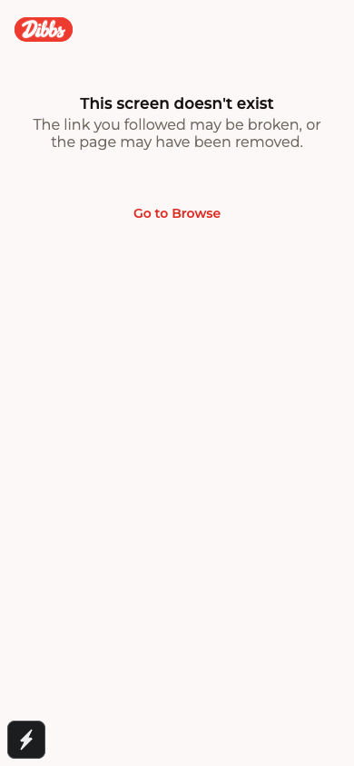

**Now:** A generic "This screen doesn't exist" empty state with a "Go to Browse" text link.

1. **[P2 · Design]** The link is a small unstyled accent text with a tiny hit area, floating below the state. Use `Button` (primary) as the `EmptyState` action, ≥48px, and add an icon. (`app/+not-found.tsx:13-21`)
2. **[P2 · Function]** Dead listing links are the most likely 404 (listing expired after 24h or was removed). Detect `/listing/…` paths and say "This listing may have expired or been removed" with a Browse CTA; otherwise the generic copy says nothing useful. (`app/+not-found.tsx:14-15`)
3. **[P3 · Function]** For signed-out visitors on the web, add a "Log in / Create account" secondary action, since public links are a committed entry point.

**Your call:**
- Add listing-specific wording for expired links?
